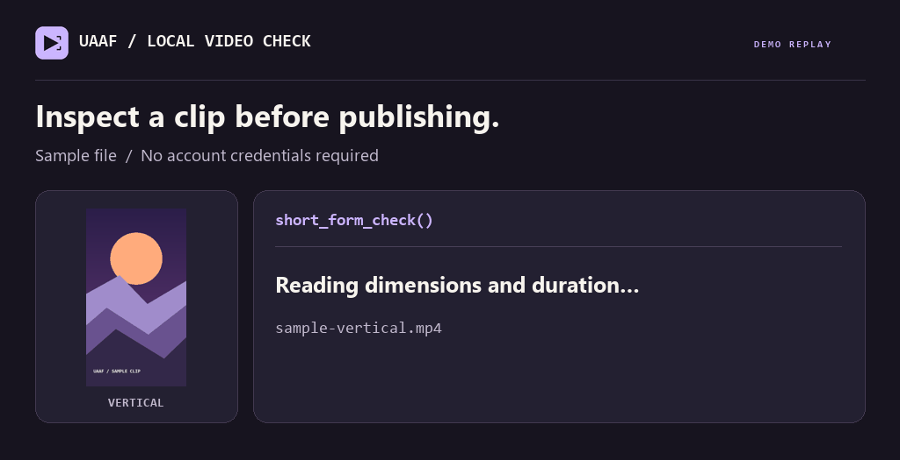

<p>
  
</p>

# UAAF Social Publisher

A self-hosted Python project for publishing short videos to the social accounts you connect. Start by checking a clip locally, then explore the publishing adapters for your channels.

[Try the video check](#try-the-video-check) · [See the workflow](#see-the-workflow) · [Publishing adapters](#publishing-adapters) · [Share feedback](https://github.com/syedsafil/uaaf-social-publisher/issues)

## Try the video check

You need Git, Python, and `ffprobe` from FFmpeg on your PATH. The local check uses the Python standard library and runs without social account credentials.

```sh
git clone https://github.com/syedsafil/uaaf-social-publisher.git
cd uaaf-social-publisher
python -m examples.check_clip examples/sample-vertical.mp4
```

The sample returns `540 × 960`, `3.0` seconds, and `"is_short_eligible": true`. This check evaluates the frame shape and duration for YouTube Shorts. It runs locally and uploads nothing.

## See the workflow

<p>
  
</p>

Replay based on actual output from the local validator. [View the static result](media/video-check.png) · [Download the sample clip](examples/sample-vertical.mp4)

The publishing code accepts a clip and its post text, dispatches to the selected adapters, and returns each platform's result. A scheduler and comment handlers are also in the repository.

## Publishing adapters

| Destination | Code in this repository | Verification |
| --- | --- | --- |
| Instagram Reels | Video publishing adapter | Live publishing pending |
| Facebook Reels | Video publishing adapter | Live publishing pending |
| TikTok | Content posting adapter | Live publishing pending |
| YouTube Shorts | Video uploading adapter and local frame/duration check | [Live publish verified](https://www.youtube.com/shorts/bjLGjKSNwJg) · Local check reproduced |
| X | Video publishing adapter | Live publishing pending |

See the [publishing code](python_agents/publish/publish_all.py) and the [environment template](.env.example) for integration entry points. Publishing requires the appropriate accounts, credentials and API access for each channel. Keep personal credentials out of issues and screenshots.

## Share feedback

If you try the local check, share your OS, Python version and the output in a [GitHub issue](https://github.com/syedsafil/uaaf-social-publisher/issues). Include the platform and a redacted error if you're reporting an adapter issue.
