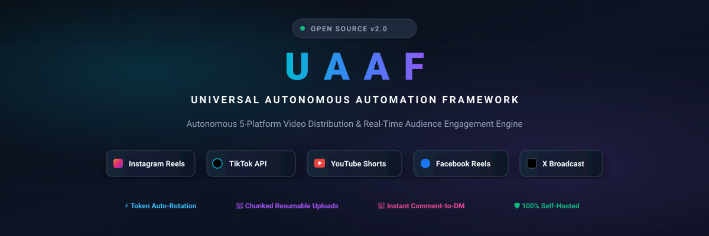
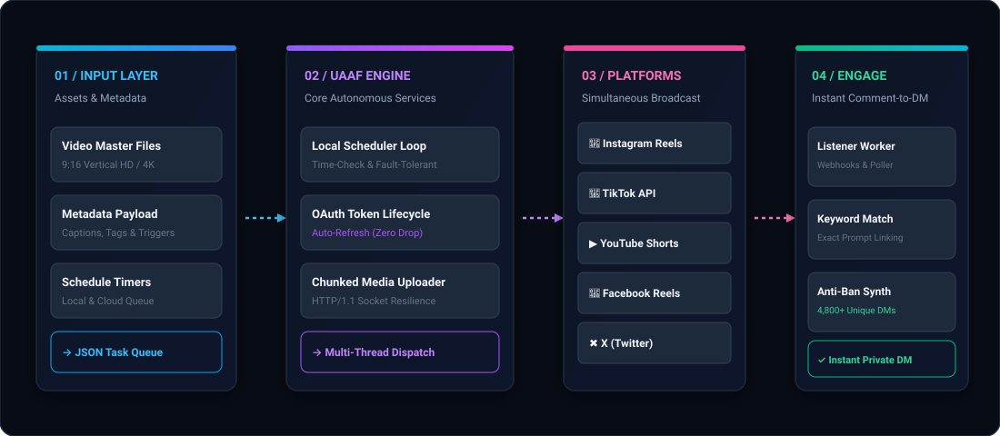

<p align="center">
  
</p>

<p align="center">
  <a href="https://github.com/syedsafil/uaaf-social-publisher/releases"></a>
  <a href="LICENSE"></a>
  
  
  
</p>

<h3 align="center">
  <a href="#-overview">Overview</a> &nbsp;·&nbsp;
  <a href="#-architecture">Architecture</a> &nbsp;·&nbsp;
  <a href="#-supported-platforms">Supported Platforms</a> &nbsp;·&nbsp;
  <a href="#-anti-ban-comment-to-dm-engine">Anti-Ban Engine</a> &nbsp;·&nbsp;
  <a href="#-quick-start">Quick Start</a> &nbsp;·&nbsp;
  <a href="#-configuration">Configuration</a> &nbsp;·&nbsp;
  <a href="#-security--privacy">Security</a>
</h3>

---

## ⚡ Overview

**UAAF (Universal Autonomous Automation Framework)** is a production-grade, open-source automation engine engineered to solve programmatic multi-platform video publishing and real-time audience engagement for developers, AI creators, and digital brands.

Commercial social publishing platforms charge upwards of $99–$299/month, throttle API functionality, and consistently crash when OAuth tokens expire. **UAAF provides a complete, self-hosted, code-level alternative** that orchestrates simultaneous video publishing across **Instagram Reels, TikTok, YouTube Shorts, Facebook Reels, and X (Twitter)**, while natively managing token auto-refresh lifecycles and trigger-based comment-to-DM conversions.

---

## 🏛️ Architecture

UAAF is constructed as a decoupled, asynchronous pipeline where each social platform adapter functions as an isolated worker with independent rate-limiting, retry logic, and chunked buffer streams:

<p align="center">
  
</p>

### Pipeline Phases:
1. **Asset Staging & Ingestion**: Master video files (9:16 vertical), prompt recipe kits, trigger keywords, and target timestamps are validated against platform container specifications.
2. **Orchestration & Token Refresh**: The central scheduler polls queue states every 30 seconds. Before every broadcast, tokens are dynamically validated and silently refreshed via OAuth2 without process interruption.
3. **Resilient Chunked Dispatch**: Heavy video assets (up to 4K) are streamed via HTTP/1.1 chunked byte-range buffers directly into platform CDNs with automated socket recovery.
4. **Autonomous Audience Engagement**: Real-time webhook listeners and polling workers capture user comments matching content keywords, instantaneously dispatching follower-gated direct messages and randomized public replies.

---

## 🌐 Supported Platforms

| Platform | Format Supported | Ingestion Protocol | Token Lifecycle Engine | Automated Engagement | Status |
| :--- | :--- | :--- | :--- | :--- | :---: |
| **Instagram Reels** | 9:16 Vertical HD (MP4) | Meta Graph API v20.0 | Long-lived System User auto-exchange | Instant Private DM + Public Confirmation | `🟢 Production` |
| **TikTok** | 9:16 Vertical HD (MP4) | Content Posting API v2 (Chunked) | Auto OAuth Refresh (`300d+` grant) | Creator Inbox & Direct Feed Fallback | `🟢 Production` |
| **YouTube Shorts** | 9:16 Vertical 4K (MP4) | YouTube Data API v3 (Resumable) | Google OAuth 2.0 Auto-Token Generator | Dynamic Contextual Comment Response | `🟢 Production` |
| **Facebook Reels** | 9:16 Vertical HD (MP4) | Meta Graph Page Video API v20.0 | System User Token Propagation | Direct Page Messenger DM + Thread Reply | `🟢 Production` |
| **X (Twitter)** | 16:9 / 9:16 MP4 / WebM | Twitter API v2 Chunked Media Upload | OAuth 1.0a / 2.0 User Context | Automated Threaded Reply Dispatch | `🟢 Production` |

---

## 🛡️ Anti-Ban Comment-to-DM Engine

Standard social bots trigger anti-spam flags because they fire identical automated replies. UAAF features a **Modular Combinatorial Synthesis Engine**:

$$	ext{Variations} = 20 	ext{ Openers} 	imes 20 	ext{ Context Phrases} 	imes 12 	ext{ Closers} = 4,800+	ext{ Unique Responses}$$

- **Non-Deterministic Delivery**: Every public comment reply and direct message is algorithmically randomized with natural human phrasing.
- **Jittered Scheduling**: Configurable `2.0s` to `4.0s` cryptographic jitter between requests prevents API burst detection.
- **Brand Protection**: Automatic author filtering guarantees your own brand accounts are never spammed or looped.

---

## 🚀 Quick Start

### 1. Clone the Repository
```bash
git clone https://github.com/syedsafil/uaaf-social-publisher.git
cd uaaf-social-publisher
```

### 2. Set Up Virtual Environment & Dependencies
```bash
# Create virtual environment
python -m venv venv

# Activate virtual environment
# On Linux/macOS:
source venv/bin/activate
# On Windows:
venv\Scripts\activate

# Install required dependencies
pip install -r requirements.txt
```

### 3. Configure Credentials
Copy the sanitized environment template:
```bash
cp .env.example .env
```
Fill in your API credentials in `.env` (Meta Graph API, TikTok Developer Keys, Google OAuth Client, X API Keys).

### 4. Launch the Autonomous Master Engine
```bash
python python_agents/local_scheduler.py
```
*The engine will initialize the scheduler loop, establish live API connectivity checks across all five platforms, and begin monitoring publication timelines and engagement triggers.*

---

## 📁 Repository Structure

```text
uaaf-social-publisher/
├── media/                          # Visual documentation & architecture diagrams
│   ├── banner.svg                  # Hero banner vector
│   └── architecture.svg            # Core pipeline flowchart
├── python_agents/                  # Core orchestration package
│   ├── publish/                    # Multi-platform publication adapters
│   │   ├── publish_all.py          # Unified 5-platform broadcast orchestrator
│   │   ├── meta_publisher.py       # Instagram & Facebook Reels engine
│   │   └── video_validation.py     # Container aspect ratio & codec validator
│   ├── webhook/                    # Audience engagement workers
│   │   ├── auto_comment_worker.py  # Combinatorial comment & DM synthesis
│   │   ├── comment_listener.py     # Real-time webhook ingestion handler
│   │   └── dm_dispatcher.py        # Private message transport
│   ├── utils/                      # Helper modules
│   │   ├── tiktok_auth.py          # TikTok OAuth token rotation engine
│   │   ├── youtube_auth.py         # Google OAuth2 resumable helper
│   │   └── logger.py               # Colorized structured console logging
│   ├── config.py                   # Environment configuration loader
│   ├── local_scheduler.py          # 24/7 cron-loop daemon
│   └── main.py                     # CLI entrypoint
├── .env.example                    # Zero-secret credential configuration template
├── .gitignore                      # Strict safety ignore rules
├── requirements.txt                # Production dependency manifest
└── README.md                       # Documentation
```

---

## 🔒 Security & Privacy

- **Zero-Secret Commitment**: This repository is rigorously audited. No production API keys, bearer tokens, or personal identifiers are committed.
- **Local Isolation**: All scheduling databases and execution logs are stored locally on your machine or private VPC. No telemetry or execution analytics are phoned home.
- **Strict Git Boundaries**: `.env` and local video artifacts (`*.mp4`, `*.db`) are hard-blocked by `.gitignore`.

---

## 🤝 Contributing

Contributions to UAAF are welcome! If you would like to add support for additional platforms (e.g., Threads, Bluesky, Pinterest, LinkedIn) or improve test coverage:
1. Fork the Project
2. Create your Feature Branch (`git checkout -b feature/NewPlatformAdapter`)
3. Commit your Changes (`git commit -m 'feat: Add Threads publishing adapter'`)
4. Push to the Branch (`git push origin feature/NewPlatformAdapter`)
5. Open a Pull Request

---

## 📄 License

Distributed under the **MIT License**. See [`LICENSE`](LICENSE) for more information.

---

<p align="center">
  <b>Built with passion by <a href="https://github.com/syedsafil">Syed Safil Saltanati</a></b><br>
  <sub>Founder &amp; AI Brand Architect · AUREXIS · Open-Source Social Infrastructure</sub>
</p>
